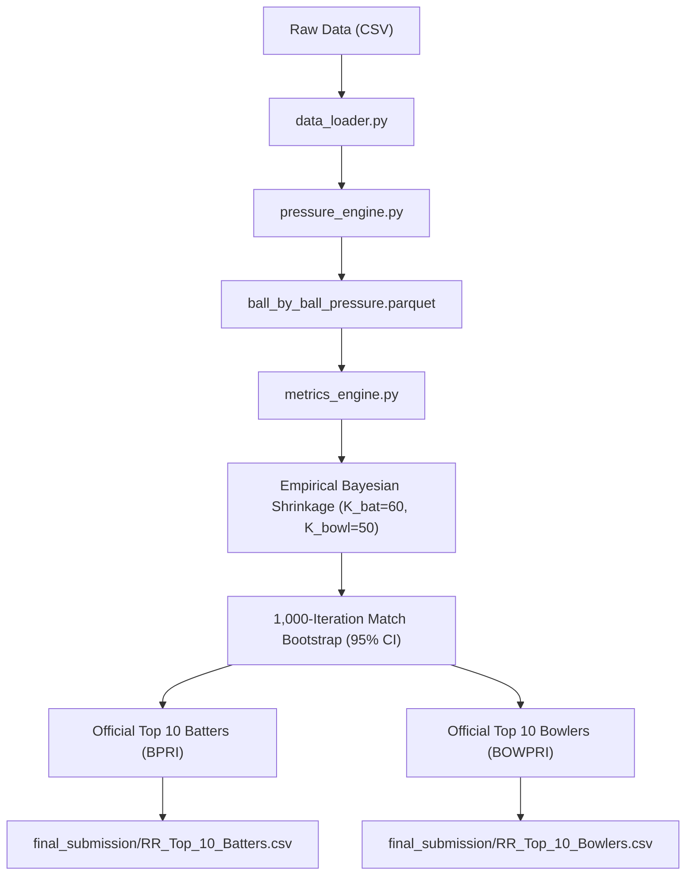

# ROYAL EDGE — Technical Architecture & Codebase Implementation Audit
**Platform:** Rajasthan Royals | IPL 2027 Auction Intelligence  
**Challenge:** SupeRR Selector Season 2 — Round 1: Identifying the Most Reliable Players Under Pressure  
**Location:** `D:\Desktop\RR - Hackathon`  
**Date:** November 10, 2026  

---

## 1. Executive Summary

This audit establishes the baseline architectural footprint of the Rajasthan Royals analytics codebase prior to transforming Stitch AI design assets into a production-grade full-stack web application. The core analytical engine, data pipeline, metric calculations, and mathematical models are verified, audited, and preserved in their pristine state.

---

## 2. Verified Data Assets & Coverage Audit

The system ingests delivery-level ball-by-ball tracking across 5 seasons of top-tier T20 cricket:

| Dataset Asset | File Path | File Size | Verified Records | Description |
| :--- | :--- | :---: | :---: | :--- |
| **Ball-by-Ball Tracking** | `data/raw/ball_by_ball.csv` | 41.07 MB | **200,999 deliveries** | Granular delivery log with over, ball, runs, extras, wickets, phase tags |
| **Match Index** | `data/raw/matches.csv` | 123.8 KB | **867 matches** | Match dates (2022-01-22 to 2026-11-01), competition IDs, venues, results |
| **Competition Mapping** | `data/raw/competitions.csv` | 7.6 KB | 28 competitions | IPL seasons 2022–2026, ICC T20 World Cups, major T20 leagues |
| **Team Mapping** | `data/raw/teams.csv` | 6.9 KB | 38 franchises/nations | Team identifiers, official names, short codes |
| **Playing XI Registry** | `data/raw/playing_eleven.csv` | 966.2 KB | 19,074 match-player rows | Match team compositions and lineups |
| **Player Identifier Mapping** | `data/raw/competition_team_player_mapping.csv` | 462.9 KB | 1,842 player entries | Normalized `player_id` to `player_name` mappings across tournaments |
| **Processed Pressure Store** | `data/processed/ball_by_ball_pressure.parquet` | 5.41 MB | **200,999 rows** | Fast vectorized Parquet store containing precomputed leverage indices & pressure tiers |

### Critical Dataset Totals
* **Total Matches:** 867
* **Total Deliveries:** 200,999
* **Total High/Extreme Pressure Deliveries:** 45,951 (22.86% of all deliveries)
* **Mapped Players:** 958 unique players evaluated

---

## 3. Core Analytics Modules & Backend Engine

The analytical pipeline is modularized in `src/`:



### Module Breakdown:
1. `src/data_loader.py`:
   - Validates schema consistency, joins matches with delivery records, resolves player identities via integer `player_id`.
   - Preserves legal ball counts ($6 - \text{wides} - \text{no\_balls}$) and extras accounting.
2. `src/pressure_engine.py`:
   - Vectorized computation of dynamic Required Run Rate (RRR), resource strain ($10 - \text{wickets lost}$), and endgame leverage.
   - Computes dynamic leverage: $L_t = \sigma(k_1 \cdot \text{RRR} - c) \cdot (1 + \text{wickets\_lost}/10) \cdot E_t$.
   - Segregates into 4 pressure tiers: Low ($<0.45$), Moderate ($0.45-0.70$), High ($0.70-0.85$), Extreme ($>0.85$).
   - 1st-innings collapse trigger ($<40$ runs at 3 down, 1.25x multiplier) and death acceleration requirements (overs 16–20).
3. `src/metrics_engine.py`:
   - Vectorized computation of Batting Pressure Reliability Index (**BPRI**) and Bowling Pressure Reliability Index (**BOWPRI**).
   - Minimum sample thresholds: Batters $\ge 10$ innings & $\ge 75$ pressure balls; Bowlers $\ge 10$ innings & $\ge 60$ legal balls.
   - Applies Empirical Bayesian Shrinkage with population priors: $K_{\text{bat}} = 60$, $K_{\text{bowl}} = 50$.
   - Generates Sample Size Saturation Index (**SSSI %**): $\min(100, \text{sample} / \text{threshold} \times 100)$.
4. `src/validation.py` & `audit/run_comprehensive_audit.py`:
   - Non-parametric cluster-level bootstrap (1,000 resamples with replacement) calculating 95% Confidence Intervals and Standard Errors for High-Pressure Strike Rate and Economy Rate.
5. `src/scouting_strategy.py`:
   - Tactical team role mapping, Sawai Mansingh Stadium venue indexing, overseas slot accounting, and actionable auction board separation.

---

## 4. Current Application Entry Points & Fallback Status

1. **Streamlit Franchise Dashboard** (`dashboard/app.py`):
   - Status: **Fully Functional** (Port 8502 fallback verified).
   - Features: Multi-page navigation (Executive Overview, Batting Analytics, Bowling Analytics, Player Comparison Radar, Auction War Room, Methodology).
   - Integration: Direct reading of `final_submission/RR_Top_10_Batters.csv`, `RR_Top_10_Bowlers.csv`, and Parquet data.
2. **Jupyter Research Notebooks** (`notebooks/`):
   - `01_data_exploration.ipynb` through `05_player_rankings.ipynb`.

---

## 5. Verified Reference Leaderboards

### Official Batting Leaderboard (BPRI)
1. **Ashutosh Sharma** (`ID: 8101` | DC) — BPRI: **78.22** | HP SR: **168.62** | 95% CI: [148.67, 189.74] | Death SR: 192.83 | SSSI: 99.0%
2. **Shashank Singh** (`ID: 2756` | PBKS) — BPRI: **77.73** | HP SR: **170.53** | 95% CI: [153.65, 186.79] | Death SR: 195.42 | SSSI: 99.0%
3. **Suryakumar Yadav** (`ID: 1699` | IND) — BPRI: **76.90** | HP SR: **182.69** | 95% CI: [170.25, 194.43] | Death SR: 217.17 | SSSI: 99.0%
4. **Tom Banton** (`ID: 6273` | ENG) — BPRI: **74.05** | HP SR: **186.84** | 95% CI: [152.63, 222.83] | Death SR: 188.57 | SSSI: 45.6%
5. **Reeza Hendricks** (`ID: 768` | SA) — BPRI: **72.93** | HP SR: **169.59** | 95% CI: [151.23, 188.77] | Death SR: 178.00 | SSSI: 99.0%
6. **Naman Dhir** (`ID: 37052` | IND) — BPRI: **72.91** | HP SR: **186.26** | 95% CI: [168.13, 207.02] | Death SR: 200.56 | SSSI: 99.0%
7. **Quinton de Kock** (`ID: 2101` | MI) — BPRI: **72.20** | HP SR: **170.33** | 95% CI: [153.41, 188.36] | Death SR: 232.00 | SSSI: 99.0%
8. **Phil Salt** (`ID: 5553` | ENG) — BPRI: **72.12** | HP SR: **187.33** | 95% CI: [164.03, 209.61] | Death SR: 208.42 | SSSI: 99.0%
9. **Rishabh Pant** (`ID: 4703` | LSG) — BPRI: **71.31** | HP SR: **176.53** | 95% CI: [157.93, 193.46] | Death SR: 200.81 | SSSI: 99.0%
10. **Tim David** (`ID: 6396` | AUS) — BPRI: **71.28** | HP SR: **181.32** | 95% CI: [169.48, 194.67] | Death SR: 200.87 | SSSI: 99.0%

### Official Bowling Leaderboard (BOWPRI)
1. **Mohammad Nawaz** (`ID: 2490` | PAK) — BOWPRI: **83.00** | HP Econ: **6.15** | 95% CI: [5.16, 7.35] | SSSI: 99.0% *(Ineligible BCCI Benchmark)*
2. **Abrar Ahmed** (`ID: 5979` | PAK) — BOWPRI: **77.96** | HP Econ: **6.51** | 95% CI: [5.44, 7.62] | SSSI: 99.0% *(Ineligible BCCI Benchmark)*
3. **Matthew Humphreys** (`ID: 22471` | IRE) — BOWPRI: **76.68** | HP Econ: **6.80** | 95% CI: [5.05, 8.69] | SSSI: 41.5% *(Eligible Overseas #1)*
4. **George Linde** (`ID: 4229` | SA) — BOWPRI: **76.10** | HP Econ: **7.38** | 95% CI: [5.30, 9.54] | SSSI: 40.0% *(Eligible Overseas #2)*
5. **Sunil Narine** (`ID: 781` | KKR) — BOWPRI: **75.71** | HP Econ: **7.27** | 95% CI: [6.47, 8.08] | SSSI: 99.0% *(Eligible Overseas #3)*
6. **Imad Wasim** (`ID: 3578` | PAK) — BOWPRI: **75.62** | HP Econ: **6.00** | 95% CI: [4.58, 7.60] | SSSI: 52.0% *(Ineligible BCCI Benchmark)*
7. **Corbin Bosch** (`ID: 3629` | MI) — BOWPRI: **74.56** | HP Econ: **7.14** | 95% CI: [5.43, 8.98] | SSSI: 63.0% *(Eligible Overseas #4)*
8. **Hasan Mahmud** (`ID: 6643` | BAN) — BOWPRI: **74.09** | HP Econ: **7.50** | 95% CI: [5.85, 9.18] | SSSI: 60.0% *(Eligible Overseas #5)*
9. **Sufiyan Muqeem** (`ID: 34485` | PAK) — BOWPRI: **73.81** | HP Econ: **4.89** | 95% CI: [3.70, 6.29] | SSSI: 73.0% *(Ineligible BCCI Benchmark)*
10. **Mitchell Santner** (`ID: 4101` | NZ) — BOWPRI: **73.53** | HP Econ: **7.21** | 95% CI: [6.45, 8.02] | SSSI: 99.0% *(Eligible Overseas #6)*

---

## 6. Full-Stack Implementation Architecture & Target Blueprint

```text
RR - Hackathon/
├── backend/                        <-- FastAPI Python Backend Server
│   ├── main.py                     <-- Entry point, CORS, router mounting
│   ├── api/
│   │   ├── overview.py             <-- Dataset totals, marquee targets
│   │   ├── players.py              <-- Batters, bowlers, profile deep-dives
│   │   ├── pressure.py             <-- Match leverage curves, phase distributions
│   │   ├── compare.py              <-- Head-to-head radar & delta comparisons
│   │   ├── auction.py              <-- Dynamic purse simulator, roster calculator
│   │   └── methodology.py          <-- Formulas, shrinkage priors, bootstrap bounds
│   └── schemas/                    <-- Pydantic request & response contracts
│
├── frontend/                       <-- React + Vite + TypeScript Frontend
│   ├── src/
│   │   ├── components/             <-- Sidebar, Header, KPI Cards, Tables, Badges
│   │   ├── pages/                  <-- 8 Dedicated Pages matching Stitch Screens
│   │   │   ├── ExecutiveOverview.tsx
│   │   │   ├── PressureIntelligence.tsx
│   │   │   ├── BattingAnalytics.tsx
│   │   │   ├── BowlingAnalytics.tsx
│   │   │   ├── PlayerComparison.tsx
│   │   │   ├── AuctionWarRoom.tsx
│   │   │   ├── PlayerProfile.tsx
│   │   │   └── Methodology.tsx
│   │   ├── charts/                 <-- Recharts Radar, Bar, Area & Scatter visuals
│   │   ├── services/api.ts         <-- Typed Axios/Fetch backend client
│   │   └── index.css               <-- Tailwind theme tokens matching Stitch spec
│   ├── package.json
│   ├── tailwind.config.js
│   └── vite.config.ts
```

---

## 7. Implementation Risks & Mitigation Strategy

1. **Data Fabrication Risk:**
   - *Mitigation:* The frontend must never use hardcoded mock player statistics. Every metric, ranking, and confidence bound will be served via FastAPI from `final_submission/RR_Top_10_Batters.csv`, `RR_Top_10_Bowlers.csv`, and `ball_by_ball_pressure.parquet`.
2. **Formula Alteration Risk:**
   - *Mitigation:* The backend will strictly reference the mathematical formulations established in `RR_Methodology.md` and verified in `audit/mathematical_audit.md`.
3. **Auction Valuation Conflation:**
   - *Mitigation:* All suggested auction bidding values will be explicitly labeled in the UI as **"Simulated Valuation Models"** with user-interactive sliders.
4. **BCCI Eligibility Integrity:**
   - *Mitigation:* Bowling screens will provide strict visual decoupling between the **10 Official Statistical Benchmarks** and the **Actionable BCCI-Eligible Shortlist**.
5. **Streamlit Disruption Risk:**
   - *Mitigation:* `dashboard/app.py` is isolated and will continue to function on port 8502 as a fallback.

